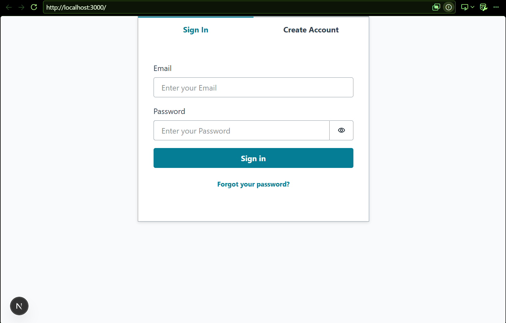
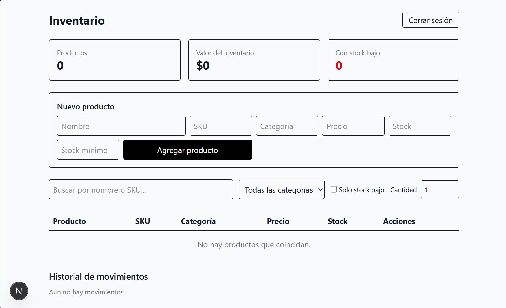
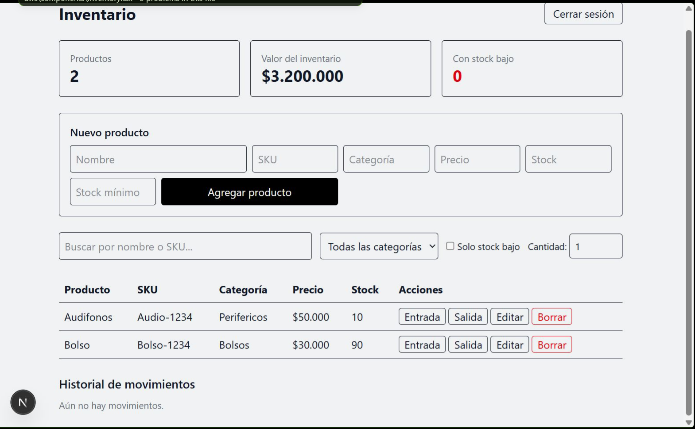
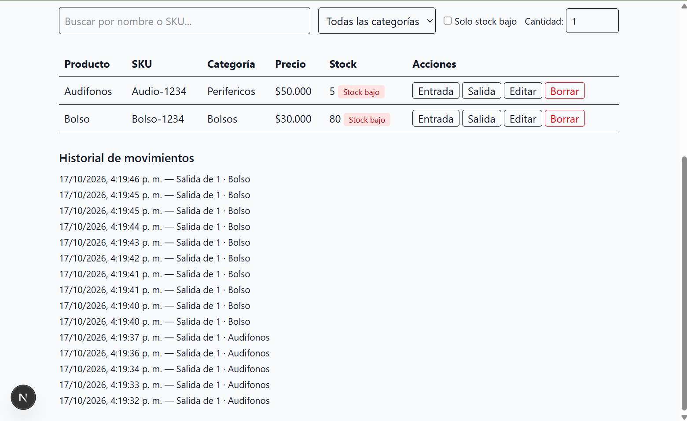

# Inventario AWS

Aplicación web full stack para gestionar el inventario de un negocio: productos, entradas y salidas de stock, alertas de stock bajo y un panel con indicadores. Cada usuario inicia sesión y ve únicamente sus propios datos.

Proyecto personal construido para practicar desarrollo web moderno y servicios en la nube de AWS.

## Capturas

### Inicio de sesión y verificación

| Inicio de sesión | Código de verificación por correo |
|---|---|
|  |  |

### Gestión del inventario







## Funcionalidades

- Registro e inicio de sesión con verificación por correo electrónico
- Datos privados por usuario: cada cuenta ve y edita solo su inventario
- Crear, editar y eliminar productos (nombre, SKU, categoría, precio, stock y stock mínimo)
- Entradas y salidas de stock con cantidad personalizada y validación de existencias
- Historial de movimientos
- Alerta visual de stock bajo
- Búsqueda por nombre o SKU, filtro por categoría y filtro de productos con stock bajo
- Panel con total de productos, valor del inventario y productos con stock bajo

## Tecnologías

- **Frontend:** Next.js (App Router), React, TypeScript, Tailwind CSS
- **Autenticación:** Amazon Cognito
- **API y base de datos:** AWS AppSync (GraphQL) y Amazon DynamoDB
- **Infraestructura como código:** AWS Amplify Gen 2 (backend definido en TypeScript)
- **Control de versiones:** Git y GitHub

## Arquitectura

```
Navegador (Next.js)
      │
      ├── Amazon Cognito ──── registro, login y sesiones
      │
      └── AWS AppSync (GraphQL) ──── Amazon DynamoDB
                                     (Product, StockMovement)
```

El backend se define en `amplify/` (autenticación y modelos de datos). Las reglas de autorización por propietario evitan que un usuario pueda leer los datos de otro.

## Estructura del proyecto

```
├── amplify/          # Backend: autenticación y modelos de datos
├── app/              # Páginas de Next.js
├── components/       # Componentes de la interfaz
├── lib/              # Tipos compartidos
└── docs/             # Capturas de pantalla
```

## Cómo ejecutarlo en local

Requisitos: Node.js (LTS), Git y una cuenta de AWS con la AWS CLI configurada.

```bash
git clone https://github.com/JSV-AFK/Inventario-Aws.git
cd Inventario-Aws
npm install
```

En una terminal, levanta el backend de prueba:

```bash
npx ampx sandbox --identifier inventario
```

Cuando termine de desplegar (genera el archivo `amplify_outputs.json`), en otra terminal:

```bash
npm run dev
```

Abre `http://localhost:3000`, crea una cuenta y empieza a registrar productos.

Para eliminar los recursos de AWS al terminar:

```bash
npx ampx sandbox delete --identifier inventario
```

## Lo que aprendí

- Diseñar una aplicación full stack con autenticación y base de datos en la nube
- Modelar datos y permisos con Amplify Gen 2 y DynamoDB
- Separar la interfaz en componentes reutilizables con TypeScript
- Trabajar con Git y GitHub, y proteger archivos de configuración sensibles

## Próximos pasos

- Despliegue público con AWS Amplify Hosting
- Imágenes de productos con Amazon S3
- Roles de usuario (administrador y empleado)
- Reportes y exportación a CSV

## Autor

**Juan Sebastián Vélez Correa**: estudiante de Ingeniería Informática

GitHub: [JSV-AFK](https://github.com/JSV-AFK)